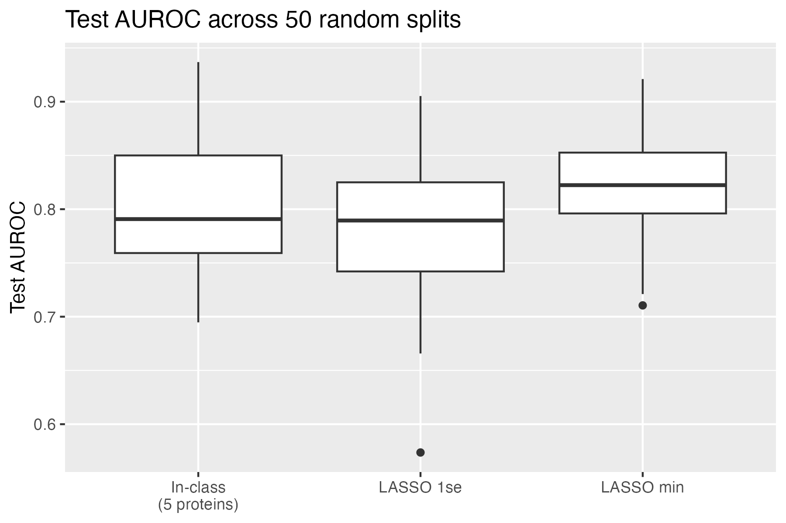
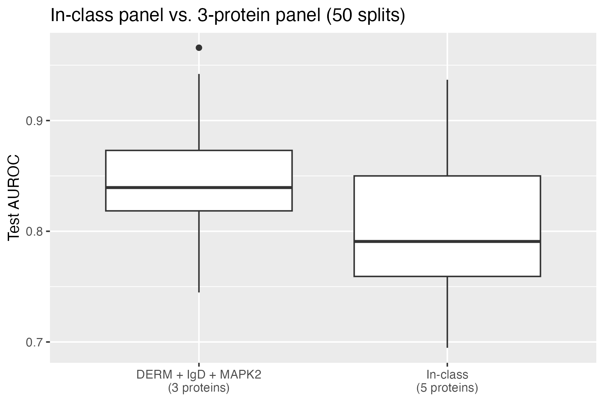

Use this as a template. Keep the headers and remove all other text. In all, your report can be quite short. When it is complete, render and then push changes to your team repository.

```{r}
# load any other packages and read data here
library(tidyverse)
library(randomForest)
library(infer)
library(tidymodels)
library(modelr)
library(yardstick)
library(glmnet)
library(pROC)
library(rsample)

var_names <- read_csv("../data/biomarker-raw.csv",
                      col_names = FALSE, n_max = 2,
                      col_select = -(1:2), show_col_types = FALSE) %>%
  t() %>%
  as_tibble() %>%
  rename(name = V1, abbreviation = V2) %>%
  na.omit()


biomarker_raw <- read_csv("../data/biomarker-raw.csv",
                          skip = 2, col_select = -2L,
                          col_names = c("group", "empty",
                                        pull(var_names, abbreviation), "ados"),
                          na = c("-", ""), show_col_types = FALSE) %>%
  filter(!is.na(group)) %>%
  select(group, ados, everything())

```

## Abstract

Write a brief one-paragraph abstract that describes the contents of your write-up.

Hewitson et al. (2021) proposed a panel of serum proteins to distinguish boys with autism spectrum disorder (ASD) from typically developing (TD) boys. We replicated a simplified version of their analysis on 154 subjects and 1,317 proteins, then tested how sensitive it is to design choices. Log transformation fixed right-skewed protein levels, and a few subjects accounted for most extreme values. \[Task 3 result.\] The in-class 5-protein panel had a mean test AUROC of 0.81 across 50 random splits, lower than its 0.88 on a single split. A 3-protein panel (DERM, IgD, MAPK2) reached 0.85, so it is simpler with comparable accuracy, but not a proven improvement. The in-class panel itself was not perfectly reproducible across runs, so any single panel should be read with caution.

## Dataset

Write a brief data description, including: how data were obtained; sample characteristics; variables measured; and data preprocessing. This can be largely based on the source paper and should not exceed 1-2 paragraphs.

The data come from Hewitson et al. (2021), a study of serum proteins in boys with and without autism spectrum disorder (ASD). Fasting blood samples were collected from 154 boys aged 18 months to 8 years: 76 with ASD (mean age 5.6 years) and 78 typically developing (TD) boys (mean age 5.7 years). Serum was analyzed on SomaLogic's SOMAscan 1.3K platform, which measured 1,317 proteins per sample. ASD was diagnosed by a clinical psychologist using the ADOS and ADI-R. The ADOS total score, a measure of symptom severity, is only available for the ASD group (mean 14.9, SD 5.05), so it was not used as a predictor in our classification analysis.

The published analysis removed 192 proteins that failed quality control, leaving 1,125. Our analysis keeps all 1,317. Following the paper, protein levels were log10 transformed, centered and scaled, and values beyond 3 standard deviations from the mean were trimmed to -3 or 3. The cleaned data contain a group label (ASD or TD), the ADOS score, and the 1,317 protein measurements for each of the 154 subjects.

## Summary of published analysis

Summarize the methodology of the paper in 1-3 paragraphs. You need not explain the methods in depth as we did in class; just indicate what methods were used and how they were combined. If possible, include a diagram that depicts the methodological design. (Quarto has support for [GraphViz and Mermaid flowcharts](https://quarto.org/docs/authoring/diagrams.html).) Provide key results: the proteins selected for the classifier and the estimated accuracy.

The authors searched for a small panel of proteins that separates ASD from TD boys. They selected the top 10 proteins by three methods: random forest importance (averaged over 1,000 forests), t-tests between groups, and correlation with ADOS total score. Five proteins appeared in all three lists (MAPK14, IgD, DERM, EPHB2, suPAR) and were called the core panel. They then added the other 13 proteins one at a time and kept four that improved accuracy (ROR1, GI24, eIF-4H, ARSB), giving a 9-protein panel. Each panel was evaluated with logistic regression, using 80/20 train/test splits repeated 1,000 times. The 9-protein panel reached a test AUROC of about 0.86, with sensitivity about 0.83 and specificity about 0.84.

The paper was retracted by PLOS ONE in 2024 because the correlation analysis wrongly included TD subjects, who were assigned made-up ADOS scores. The correlation-based selection, and therefore the 9-protein panel, is not reliable. Our in-class version of the analysis used only the t-test and random forest methods and combined them by intersection. It also simplified the paper by fitting one forest, skipping forward selection, and using a single train/test split.

```{mermaid}
flowchart LR
  A["154 boys, 1,317 proteins"] --> B["Drop 192 failed QC; log10, scale, clip at 3 SD"]
  B --> C["Random forest: top 10"]
  B --> D["t-test: top 10"]
  B --> E["Correlation with ADOS: top 10"]
  C --> F["Intersection: 5 core proteins"]
  D --> F
  E --> F
  F --> G["Add 13 other proteins one at a time"]
  G --> H["9-protein panel"]
  H --> I["Logistic regression, 80/20 split x1000, AUROC 0.86"]
```

## Findings

Summarize your findings here. I've included some subheaders in a way that seems natural to me; you can structure this section however you like.

### Impact of preprocessing and outliers

**Task 1: Log Transformation**

We compared the first four proteins in the data (CEBPB, CHIP, NSE, PIAS4) before and after a log10 transform.

```{r}
proteins <- setdiff(names(biomarker_raw), c("group", "ados"))
sample_proteins <- head(proteins, 4)

sample_distributions <- biomarker_raw %>%
  select(all_of(sample_proteins)) %>%
  pivot_longer(everything(), names_to = "protein", values_to = "raw_level") %>%
  mutate(log_level = log10(raw_level)) %>%
  pivot_longer(c(raw_level, log_level), names_to = "version", values_to = "level") %>%
  mutate(version = recode(version, raw_level = "Raw", log_level = "Log10"))


p_raw_log <- ggplot(sample_distributions, aes(x = level)) +
  geom_histogram(bins = 25, fill = "steelblue", color = "white") +
  facet_wrap(~ protein + version, scales = "free_x", ncol = 4) +
  labs(
    title = "Protein distributions before and after log10 transformation",
    x = "Protein measurement (scale shown in panel)",
    y = "Number of subjects"
  ) +
  theme_minimal()
print(p_raw_log)
```

The raw levels are **right-skewed**. Most values are small and a few are very large, especially for CHIP and NSE. Protein levels span orders of magnitude, so a handful of huge values would dominate means and t-tests. Logging makes the distributions more symmetric and cuts the influence of those values.

**Task 2: Outlier Trimming**

We removed the trimming step and counted, for each subject, the protein measurements more than 3 SD from the mean. Outliers were concentrated in a few subjects. Subject 154 (TD) had the most with 157 outlying values, followed by subject 108 (TD) with 127 and subject 9 (ASD) with 126.

```{r}
biomarker_untrimmed <- biomarker_raw %>%
  mutate(subject_id = row_number()) %>%
  mutate(across(all_of(proteins),
                ~ as.numeric(scale(log10(.x)))))

subject_outliers <- biomarker_untrimmed %>%
  pivot_longer(cols = all_of(proteins),
               names_to = "protein", values_to = "z_score") %>%
  group_by(subject_id, group) %>%
  summarise(n_outliers = sum(abs(z_score) > 3, na.rm = TRUE),
            .groups = "drop")

group_summary <- subject_outliers %>%
  group_by(group) %>%
  summarise(mean_outliers = mean(n_outliers),
            median_outliers = median(n_outliers),
            .groups = "drop")

group_summary
slice_max(subject_outliers, n_outliers, n = 5)
```

TD subjects averaged more outliers than ASD subjects (17.6 vs. 13.3), but the medians were identical (8.5). The gap comes from a few extreme subjects like 154 and 108, not a general TD pattern. Of the eight subjects with the most outliers, five were TD and three were ASD, which is too few to show a real group difference. We see no clear difference between groups.

Even the typical subject sits above what a normal distribution would give. A 3 SD cutoff across 1,317 proteins predicts about 3.6 outliers per subject, versus a median of 8.5 here. Since a small number of subjects contribute a large share of the extreme values, trimming limits how much they can sway the t-tests and the random forest.

### Methodological variations

Task 3

We tried the three modifications one at a time. Each was evaluated with a single 80/20 split, so test sets contain only 31 subjects and the results are noisy: one misclassified subject changes sensitivity by about 0.06. For comparison, the in-class panel (DERM, RELT, MRC2, IgD, Cadherin-5) had a test AUROC of 0.883 and accuracy of 0.774.

Training partition. Choosing proteins using only the training subjects gave a 4-protein panel (DERM, IgD, TSP4, MRC2). It shares DERM, IgD, and MRC2 with the in-class panel. Test AUROC dropped from 0.883 to 0.846 and accuracy from 0.774 to 0.710, with sensitivity falling from 0.812 to 0.688 and specificity unchanged at 0.733. This is the expected direction, since in the in-class analysis the test subjects helped choose the proteins, which makes its results optimistic.

More proteins per method. Using the top 15 from each method gave an 8-protein panel (DERM, RELT, IgD, PTN, FSTL1, MAPK2, TGF-b R III, gp130). Test AUROC was 0.857 and accuracy 0.710, so a larger list did not improve performance on this split.

Fuzzy intersection. Taking the union of the two top-10 lists gave 16 proteins. Test AUROC was 0.781, the lowest of the three, with accuracy 0.742. With only 123 training subjects, a 16-protein model likely overfits.

DERM and IgD appeared in every panel we built, so they look like the most stable signals. Because the splits differ and the sample is small, we do not draw firm conclusions about which modification is best.

### Improved classifier

Task 4

We looked for a simpler panel with comparable accuracy to the in-class panel (DERM, RELT, MRC2, IgD, Cadherin-5). The in-class single-split AUROC of 0.883 is optimistic, since proteins were chosen using all 154 subjects. So we benchmarked everything on the same 50 random 75/25 splits, stratified by group.

On each split we fit a LASSO logistic regression with 5-fold CV on the training data only, at `lambda.min` and `lambda.1se`. We then took the three proteins the `lambda.1se` LASSO picked most often (DERM, IgD, MAPK2) as a fixed panel. A panel counts as *simpler* if it has fewer than 5 proteins and a mean AUROC within about one SD of the baseline. It counts as *improved* if it beats the baseline by about one SD. This is a heuristic, not a formal test.

| Method                    | Mean test AUROC | SD    | Proteins |
|---------------------------|-----------------|-------|----------|
| In-class panel (baseline) | 0.806           | 0.062 | 5        |
| LASSO, `lambda.1se`       | 0.784           | 0.066 | 15.5     |
| LASSO, `lambda.min`       | 0.819           | 0.047 | 40.0     |
| DERM + IgD + MAPK2        | 0.848           | 0.046 | 3        |





Neither LASSO panel was simpler or better. The 3-protein panel scored 0.042 higher than the baseline on average (paired SD 0.041), which is less than the baseline's SD of 0.062. So we claim **comparable accuracy with fewer proteins**, not a proven improvement.

*Caveats:* the in-class panel and the 3-protein panel were both chosen using data that also ended up in test sets, so both estimates are somewhat optimistic. With 154 subjects, AUROC swings a lot across splits, so small differences shouldn't be over-read.
